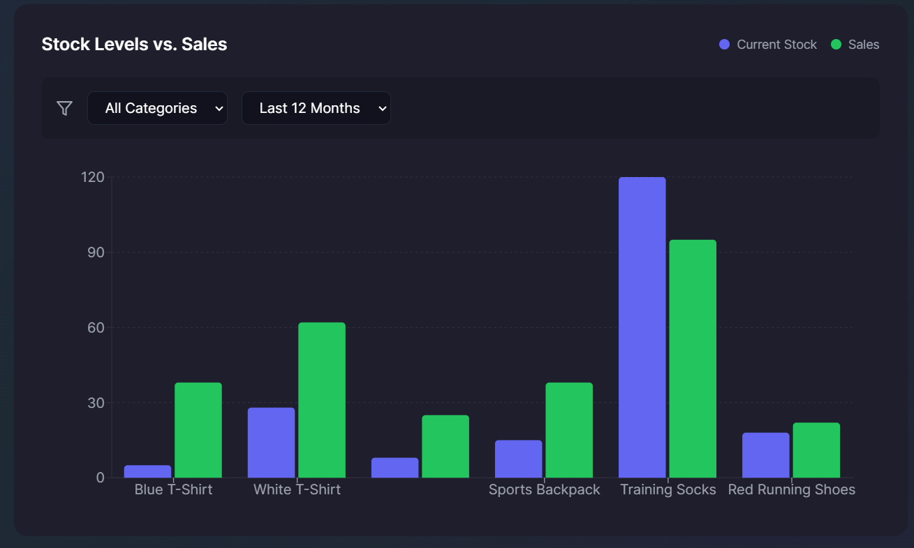

# StockPilot AI 🚀

StockPilot AI is an open-source inventory analytics dashboard for **Shopify** and **WooCommerce** stores. It pulls your products and orders, flags stockouts and dead stock, forecasts demand, and uses an LLM to write restock recommendations and answer questions about your store data.


<p align="center"><i>Dashboard Preview</i></p>

> **Self-hosted, bring your own keys.** StockPilot used to be a paid hosted service. It is now fully open source: there are no plans, no payments, and no shared API keys. You deploy your own copy and connect your own Firebase project, OpenAI key and (optionally) Shopify app.

The repository holds two separate projects:

- **The app** (repository root): sign-in, the dashboard, the public demo and the `/api` backend. This is all you need to run StockPilot for your own stores.
- **The marketing site** ([`landing/`](landing/)): the landing page, blog and legal pages of the original stockpilotai.com. It's optional and has its own `package.json`. If you're self-hosting, you can ignore it or delete the folder.

## Features 🌟

- **Multi-store dashboard**: connect several Shopify and WooCommerce stores to one account and switch between them, or view them all merged by SKU.
- **Inventory alerts**: low stock, stockouts, dead stock and overstock, with thresholds you set.
- **Forecasts**: per-SKU demand and stock-cover projections.
- **AI restock recommendations**: generated from your filtered inventory data, cached per store for a week.
- **AI chat assistant**: ask questions about your products and orders in plain language.
- **Public demo**: `/demo` shows the whole dashboard on synthetic data, with no sign-in.

## How it fits together 🛠️

| Layer | What | Where |
| --- | --- | --- |
| Frontend | React 18 + TypeScript, Vite, Tailwind, MUI, Recharts / Chart.js | `src/` |
| API | Cloudflare Pages Functions (Shopify/WooCommerce proxies, OAuth, OpenAI proxy) | `functions/` |
| Auth & data | Firebase Authentication + Cloud Firestore | `firestore.rules` |
| AI | OpenAI Chat Completions, or any OpenAI-compatible endpoint | `functions/lib/openai.ts` |
| Marketing site (optional) | Landing page, blog, legal pages - static React + Tailwind | `landing/` |

Secrets (your OpenAI key, Shopify app secret, Firebase service account) live only in the Pages Functions environment. The browser calls `/api/*` with a Firebase ID token and never sees them.

## Self-hosting guide 🚀

### 1. Prerequisites

- Node.js 20+
- A [Firebase](https://console.firebase.google.com) project (free Spark plan is enough)
- An [OpenAI API key](https://platform.openai.com/api-keys) (optional: without it, everything except the AI features works)
- A [Cloudflare](https://dash.cloudflare.com) account to deploy (optional for local use)

```bash
git clone https://github.com/alex-kazos/stockpilot-open.git
cd stockpilot-open
npm install
```

### 2. Firebase

1. Create a Firebase project.
2. **Authentication → Sign-in method**: enable **Email/Password** and **Google**.
3. **Firestore Database**: create a database (production mode), then paste the contents of [`firestore.rules`](firestore.rules) into the **Rules** tab and publish. Or, with the Firebase CLI: `npx firebase-tools deploy --only firestore --project <your-project-id>`.
4. **Project settings → General → Your apps**: add a Web app and copy its config into a new `.env` file (template: [`.env.example`](.env.example)):

   ```bash
   cp .env.example .env
   ```

5. **Project settings → Service accounts → Generate new private key**: from the downloaded JSON, copy `client_email` and `private_key` into `.dev.vars` (template: [`.dev.vars.example`](.dev.vars.example)):

   ```bash
   cp .dev.vars.example .dev.vars
   ```

   Never commit `.env`, `.dev.vars` or the service-account JSON (all three are git-ignored).

### 3. OpenAI

Put your own key in `.dev.vars` as `OPENAI_API_KEY`. Optional knobs, all in the same file:

| Variable | Default | Purpose |
| --- | --- | --- |
| `OPENAI_CHAT_MODEL` | `gpt-5.6-luna` | Model for the chat assistant |
| `OPENAI_RECOMMENDATIONS_MODEL` | `gpt-5.6-terra` | Model for restock recommendations (must support JSON mode) |
| `OPENAI_BASE_URL` | `https://api.openai.com/v1` | Any OpenAI-compatible endpoint (Azure OpenAI, OpenRouter, a local server, ...) |
| `OPENAI_PROJECT_ID` | none | Only for project-scoped keys |
| `AI_CHAT_MONTHLY_LIMIT` | `120` | Per-user monthly cap on chat messages, so one account can't run up your bill |

If `OPENAI_API_KEY` is missing, the AI endpoints return `503` and the rest of the dashboard keeps working.

### 4. Connecting stores

Users connect their stores from the dashboard after signing in. Every store's credentials are stored per user in Firestore.

**WooCommerce: nothing to configure.**
- *One-click*: uses WooCommerce's built-in [application authentication](https://developer.woocommerce.com/docs/apis/rest-api/authentication/#application-authentication). The store's server POSTs the generated keys back to `/api/woocommerce/oauth/callback`, so your deployment must be reachable from the internet (this won't work against `localhost`).
- *Manual*: in WordPress go to **WooCommerce → Settings → Advanced → REST API**, create a key with **Read** permission, and paste the consumer key/secret.

**Shopify: pick one.**
- *Access token (simplest, for your own store)*: create a custom app for your store with the `read_products` and `read_orders` Admin API scopes (`read_customers` is optional), install it, and paste its Admin API access token in the **Advanced** tab of the connect screen. No server configuration needed. See Shopify's docs on [custom apps](https://help.shopify.com/en/manual/apps/app-types/custom-apps).
- *One-click OAuth*: create your **own** app in the [Shopify Partner Dashboard](https://partners.shopify.com) and add `https://<your-domain>/api/shopify/oauth/callback` (and `http://localhost:8788/api/shopify/oauth/callback` for local dev) to its allowed redirection URLs. Then set `SHOPIFY_API_KEY`, `SHOPIFY_API_SECRET` and `SHOPIFY_SCOPES` in `.dev.vars`. An app with *custom distribution* can only be installed on the store or organization you choose when you create the install link. To let any merchant connect, the app needs *public* distribution, which means going through Shopify's app review.

### 5. Run it locally

```bash
npm run dev
```

starts Vite on http://localhost:5173 (`/` takes you to sign-in, then the dashboard). That serves the UI only: `/api/*` returns 404 (HTML) because the Pages Functions aren't running. For the full stack, build and serve through Wrangler, which also loads `.dev.vars`:

```bash
npm run build
npx wrangler pages dev dist
```

then open http://localhost:8788. Re-run the build after frontend changes.

### 6. Deploy to Cloudflare Pages

1. Create a Pages project. Either connect your Git repo (build command `npm run build`, output directory `dist`), or deploy from your machine with `npm run deploy:frontend`.
2. **Settings → Environment variables**:
   - Every `VITE_FIREBASE_*` value from `.env` (they're inlined into the frontend at build time, so they must be available to the build).
   - Every value from `.dev.vars`, as encrypted secrets.
3. In Firebase **Authentication → Settings → Authorized domains**, add your Pages domain (and any custom domain).
4. If you use Shopify OAuth, add the production callback URL to your Shopify app.

## Marketing site (optional) 🌐

[`landing/`](landing/) is the public website that sits in front of the app: landing page, blog, Privacy Policy and Terms. It's a static Vite + React + Tailwind site with no backend and no Firebase, and it links to the app through `VITE_APP_URL`.

```bash
cd landing
cp .env.example .env   # VITE_APP_URL=http://localhost:5173
npm install
npm run dev            # http://localhost:5174
```

To deploy it, create a second Cloudflare Pages project (or use any static host) with root directory `landing`, build command `npm run build`, output directory `dist`, and set `VITE_APP_URL` to the app's URL (for example `https://app.example.com`).

Everything in it describes the original stockpilotai.com and its operator: the copy, `index.html` meta tags, `public/sitemap.xml`, the legal text and contact email in `src/data/legalContent.ts`, and the author links in `src/components/Footer.tsx`. Replace them before publishing your own.

## Environment variables 🔐

**Frontend (`.env`, inlined at build time, public):**
`VITE_FIREBASE_API_KEY`, `VITE_FIREBASE_AUTH_DOMAIN`, `VITE_FIREBASE_PROJECT_ID`, `VITE_FIREBASE_STORAGE_BUCKET`, `VITE_FIREBASE_MESSAGING_SENDER_ID`, `VITE_FIREBASE_APP_ID`

**Server (`.dev.vars` locally, Pages environment variables in production, secret):**

| Variable | Required | Notes |
| --- | --- | --- |
| `VITE_FIREBASE_PROJECT_ID` | yes | Same value as the frontend one |
| `FIREBASE_CLIENT_EMAIL` | yes | Service account |
| `FIREBASE_PRIVATE_KEY` | yes | Service account, with literal `\n` line breaks |
| `OPENAI_API_KEY` | for AI features | Plus the optional knobs listed in [step 3](#3-openai) |
| `SHOPIFY_API_KEY` | for Shopify one-click | Your Shopify app's client ID |
| `SHOPIFY_API_SECRET` | for Shopify one-click | Your Shopify app's client secret |
| `SHOPIFY_SCOPES` | no | Default `read_products,read_orders,read_customers` |

## Project structure 📁

```
stockpilot-open/
├── landing/                   # Optional marketing site (separate project - see above)
├── functions/                 # Cloudflare Pages Functions (the /api backend)
│   ├── api/
│   │   ├── account/           # Delete-my-data endpoint
│   │   ├── openai/            # Chat + recommendations proxy, usage quota
│   │   ├── shopify/           # Shopify Admin API proxy + OAuth start/callback
│   │   └── woocommerce/       # WooCommerce REST proxy + app-auth start/callback
│   └── lib/                   # Auth (ID token verification), Firestore REST, OpenAI client, prompt safety
├── src/
│   ├── components/            # Dashboard, onboarding, integrations, assistant
│   ├── contexts/              # Auth, filters, AI assistant
│   ├── hooks/                 # Store data, preferences, dashboard presets
│   ├── pages/                 # Routes: auth, dashboard, demo
│   ├── services/              # Shopify/WooCommerce clients, cache, store health
│   └── utils/                 # Metrics, forecasting, query analyzer, OpenAI client calls
├── firestore.rules            # Firestore security rules
└── public/                    # Static assets
```

## Data model

```
users/{uid}
├── stores/{storeId}           # Connected store + its credentials (shopUrl/apiToken or storeUrl/consumerKey/consumerSecret)
├── settings/{doc}             # Preferences and thresholds
├── dashboardLayouts/{key}     # Overview layout per store view
└── aiUsage/{doc}              # Chat quota counter + cached recommendations (server-written only)
shopifyOAuthState/{state}      # One-time OAuth state (server-only)
woocommerceOAuthState/{nonce}  # One-time app-auth nonce (server-only)
```

## Development

```bash
npm test                     # Vitest (frontend + functions)
npm run typecheck:functions  # Typecheck the Pages Functions
npm run lint

cd landing && npm test && npm run build   # The marketing site, separately
```

Contributions are welcome: open an issue or a pull request.

## License 📄

MIT. See [LICENSE](./LICENSE).
